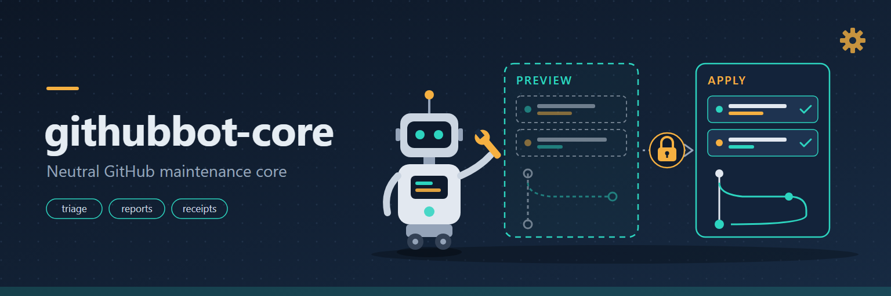

# githubbot-core

<p align="center"></p>

[English](README.md) | **Deutsch**

Neutraler, installierbarer Kern für die Pflege von GitHub-Repositories: Issue-Triage,
Duplikaterkennung, Pull-Request-Zusammenfassungen, lesende Berichte zu Gesundheit, Traffic und
Sternen, ein Vorschau-/Ausführungsvertrag für jede Schreibaktion, eine Plugin-Schnittstelle (SPI)
und signierte Exact-SHA-Review-Belege. Reine Python-Standardbibliothek, keine Laufzeitabhängigkeiten.

> Status: Alpha (0.2.1). Verbindlich sind CLI, JSON-Ergebnishülle und SPI-Version 1; alles andere
> kann sich noch ändern.

## Funktionen

- **Triage** – ordnet offene Issues über konfigurierbare Stichwortkriterien ein und plant Labels
  und Auto-Kommentare (mit unsichtbarem Marker, damit nie doppelt kommentiert wird).
- **Duplikate** – Jaccard-Ähnlichkeit auf Wort-Tokens, offline auf einer JSON-Datei.
- **Pull-Request-Zusammenfassung** – Größenprüfung und Zusammenfassung; projektspezifische
  Policy-Prüfungen kommen ausschließlich aus Plugins.
- **Berichte** – Dependabot, Actions, Issues, PRs, Code- und Secret-Scanning, Traffic (14 Tage)
  und Sterne-Rangliste. Nur lesend.
- **Vorschau / Ausführen** – ohne `--apply` wird nichts geschrieben. Jede Schreibaktion ist eine
  `Action`, wird gegen eine Rechteobergrenze geprüft und hinterlässt einen Beleg. Mit einem
  Belegspeicher überspringen Wiederholungsläufe bereits ausgeführte Aktionen.
- **Plugin-SPI** – Erweiterungen schlagen Aktionen vor oder ergänzen PR-Prüfungen über einen
  Entry Point. Eine fehlende Erweiterung wird als „nicht verfügbar“ gemeldet; der Kern läuft weiter.
- **Credential-Adapter** – Tokens kommen zur Laufzeit aus `GH_TOKEN` / `GITHUB_TOKEN` oder
  `gh auth token`. Nichts wird gespeichert oder mitgeliefert.
- **Review-Gate** – signierte (OpenSSH), befristete Belege, gebunden an Repository, PR-Nummer und
  den exakten Head-SHA; geprüft von einem GitHub-Actions-Workflow, der nie PR-Code ausführt.

## Installation

Voraussetzungen: Python 3.10+, die [GitHub CLI](https://cli.github.com/) (`gh auth login`) für
Befehle mit GitHub-Zugriff, OpenSSH `ssh-keygen` für Review-Gate-Signaturen.

```bash
pip install git+https://github.com/dev-bricks/githubbot-core.git
githubbot-core --version
githubbot-core doctor
```

Aus einem Checkout: `pip install .` (Entwicklung: `pip install -e ".[dev]"`).

## Verwendung

```bash
# Lesende Berichte
githubbot-core health --repo owner/repo --repo owner/other
githubbot-core traffic --repo owner/repo
githubbot-core stars --repo owner/repo

# Triage: Vorschau (Standard) -> genau diesen Plan ausführen
githubbot-core triage --repo owner/repo
githubbot-core --json triage --repo owner/repo            # plan_sha256 notieren
githubbot-core triage --repo owner/repo --apply --expect-plan <plan_sha256> --receipts receipts.jsonl

# Offline-Helfer (JSON-Datei im gh- oder REST-Issue-Format)
githubbot-core classify --input issues.json
githubbot-core duplicates --input issues.json --threshold 0.8

# Pull-Request-Zusammenfassung (+ Prüfungen installierter Plugins)
githubbot-core review-pr --repo owner/repo --pr 12

# Plugins und Systemagent-Vorlage
githubbot-core plugins
githubbot-core --json system-agent
githubbot-core run <plugin> [--plugin-arg ...] [--apply]
```

`python -m githubbot_core ...` funktioniert genauso.

### JSON-Vertrag

Mit `--json` gibt jeder Befehl genau eine Hülle aus:

```json
{"schema": "githubbot-core.result/v1", "command": "triage", "ok": true,
 "mode": "preview", "data": {"plan_sha256": "…", "actions": [], "writes": 0}, "errors": []}
```

`mode` ist `read`, `preview` oder `apply`. Exit-Codes: `0` ok, `1` Laufzeitfehler (z. B. GitHub
nicht erreichbar oder Schreibaktion fehlgeschlagen), `2` Konfigurations- oder Aufruffehler,
`3` Plugin nicht verfügbar.

Die Python-API ist das Paket selbst: `githubbot_core.triage.IssueTriage`,
`githubbot_core.actions.preview/apply`, `githubbot_core.health.RepoHealthCollector`,
`githubbot_core.plugins`, `githubbot_core.review_gate`, `githubbot_core.credentials`.

### Systemagent-Vorlage

`githubbot-core --json system-agent` gibt die neutrale, mit dem Paket ausgelieferte Agentenvorlage aus
(Schema `githubbot-core.system-agent/v1`): `version` (Paketversion), `sha256` über das kanonische JSON von `{schema, id, blueprint}` (nachrechenbar aus der Ausgabe),
`capability`, die wirksamen `permissions` und ein `blueprint` mit den Feldnamen des
Agent-Studio-Blueprint-Payloads (Persona, Rolle, Contractus, Governance, Skills). Die Vorlage
existiert nur dort, wo das Paket installiert ist. Konsumenten binden einen Agenten an `version` +
`sha256` und überschreiben bei einer neueren Vorlage keine bestehende Agentenkonfiguration.

## Konfiguration und Rechte

Die mitgelieferten Standardwerte (`githubbot_core/default_config.json`) werden durch
`--config datei.json`-Schichten in Reihenfolge ergänzt (etwa ein Profil, danach eine hostlokale
Datei). Gewöhnliche Schlüssel werden zusammengeführt, spätere Schichten gewinnen.
Rechteobergrenzen sind anders: Eine spätere Schicht darf `permissions.ceiling` und
`permissions.api_write_prefixes` nur **einengen**; ein Erweiterungsversuch ist ein Fehler, keine
stille Überschreibung. `permissions.enabled` muss innerhalb der Obergrenze bleiben.

| Aktionsart | Standard | Ausführung |
|---|---|---|
| `issue.add_labels` | aktiv | `POST /repos/{repo}/issues/{n}/labels` |
| `issue.comment` | aktiv | `POST /repos/{repo}/issues/{n}/comments` |
| `api.request` | aus | beliebige Schreibmethode auf einem Endpunkt, der mit einem Eintrag aus `permissions.api_write_prefixes` beginnt |

```json
{"permissions": {"enabled": ["issue.add_labels", "issue.comment", "api.request"],
                 "api_write_prefixes": ["user/starred/"]}}
```

## Ein Plugin schreiben (SPI v1)

Einen Entry Point in der Gruppe `githubbot_core.plugins` deklarieren, der auf eine Factory ohne
Argumente zeigt:

```toml
[project.entry-points."githubbot_core.plugins"]
my-extension = "my_extension:create"
```

```python
from githubbot_core.actions import Action
from githubbot_core.plugins import SPI_VERSION


class MyExtension:
    name = "my-extension"
    spi_version = SPI_VERSION

    def describe(self):
        return {"version": "1.0.0", "capabilities": ["plan"]}

    def plan(self, ctx):  # ctx.config, ctx.transport (nur lesend), ctx.args
        data, error = ctx.transport.get("repos/owner/repo")
        return [Action("api.request", {"method": "PUT", "endpoint": "user/starred/owner/repo"}, reason="example")]

    def pr_policy_checks(self, pr, files, diff):  # optional
        return [("no_large_binaries", True, "OK")]


def create():
    return MyExtension()
```

Plugins schreiben nie selbst: Der Kern zeigt ihren Plan als Vorschau oder führt ihn unter den
konfigurierten Rechten aus. Beim Planen erhalten sie nur einen lesenden Transport.

## Review-Gate

`githubbot-core gate-scaffold --dest <checkout> [--namespace name]` zeigt als Vorschau und schreibt
mit `--apply` die Dateien `.github/workflows/review-gate.yml` und den eigenständigen Prüfer
`.github/review-gate/review_gate.py` in ein Ziel-Repository. Belege werden mit
`githubbot-core review-gate create|sign|verify|dispatch` erzeugt, signiert, geprüft und übermittelt.
Details, Vertrauensgrenzen und Rollback: [docs/REVIEW_GATE.md](docs/REVIEW_GATE.md) (Englisch).

## Entwicklung

```bash
pip install -e ".[dev]"
python -m pytest            # Unit- und Vertragstests
ruff check .
ruff format --check .
GITHUBBOT_CORE_CONSUMER_TEST=1 python -m pytest tests/test_consumer_install.py   # Installationstest im frischen venv
```

## Herkunft

Geschrieben von Lukas Geiger mit KI-Unterstützung (Codeerzeugung und Review durch große
Sprachmodelle), aus einem privaten Pflegewerkzeug herausgelöst und als neuer Baum ohne dessen
Historie aufgebaut. Es ist kein Fremdcode enthalten; siehe
[THIRD_PARTY_LICENSES.md](THIRD_PARTY_LICENSES.md).

## Lizenz

[MIT](LICENSE)


## MULTI-BOT als optionale Agentenrolle

`python -m githubbot_core multi-bot` startet die paketierte Rolle über TASKPLAN. Modus 1
(`triage`) erfasst Akutes einmalig, Modus 2 (`review-merge`) wiederholt unabhängige Reviews,
Modus 3 (`aftercare`) ergänzt Pflege. Das Startcenter kann denselben CLI-Aufruf benutzen.
`--provider`, `--model`, `--effort` und `--mode` wählen ausdrücklich; die Provider-Ausführung
bleibt in TASKPLAN. Fehlt dieses optionale Modul, erscheint ein Installationshinweis und
kein Anbieter startet. `--dry-run` aktiviert TASKPLANs Trockenlauf ohne Sonde.

Wheel und sdist enthalten den deutschen Prompt, neutrale Windows-/POSIX-Starter und die
Care-/Probe-Helfer. Ressourcen: `githubbot_core/prompts/MULTI-BOT.de.md`,
`githubbot_core/starters/windows/MULTI-BOT.bat`, `starters/windows/providers/`,
`starters/posix/start-multi-bot.sh`. Auf POSIX funktioniert `sh start-multi-bot.sh` auch
bei verlorenem Ausführungsrecht. Systemprofil: `githubbot-core --json system-agent`
exportiert zusätzlich drei Rollen mit Blueprint- und Prompt-Hash; der bisherige
Standard-Blueprint bleibt kompatibel.

Standardmäßig ist der Betriebsroot das aktuelle Verzeichnis, Merge deaktiviert und
Vollzugriff nicht erzwungen. Explizite private Konfiguration: `multi_bot.root`,
`instance_prompt`, `merge_account`, `merge_enabled`, optional `trusted_automation` in
`--config DATEI`; `MULTIBOT_ROOT`/`MULTIBOT_INSTANCE_PROMPT` sind entsprechende Overrides.
Der Starter lädt keine Tokens aus einem festen Credential-Ordner. Konten, Auth, Slots und
Hostpfade gehören in die Instanz, niemals in die neutrale Vorlage. Core-Permissions können
weiterhin nur eingeschränkt werden; der Rollenprompt erweitert die Aktionsrechte nicht.

`githubbot-core multi-bot-care --root PFAD next` und `multi-bot-probe --root PFAD` lesen
explizite Instanzdaten (`config/repo_registry.json`, `config/orgs.json`, Hostlogs). Ohne
Daten melden sie HOLD. Claims ersetzen keine Projektsperren; keine ausführbare Merge-Automatik
oder neue Hintergrundroutine wird installiert. Private Extensions und private Runtime
bleiben eigenständige, getrennte Konsumenten.
